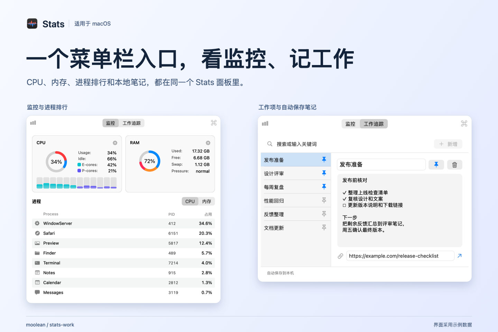
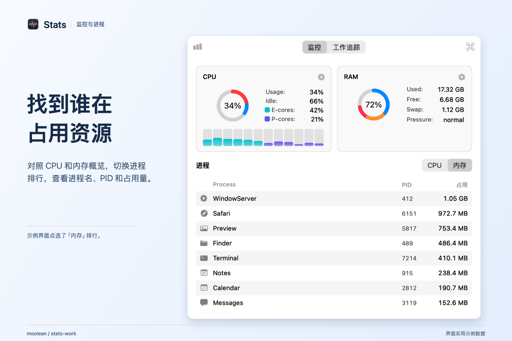
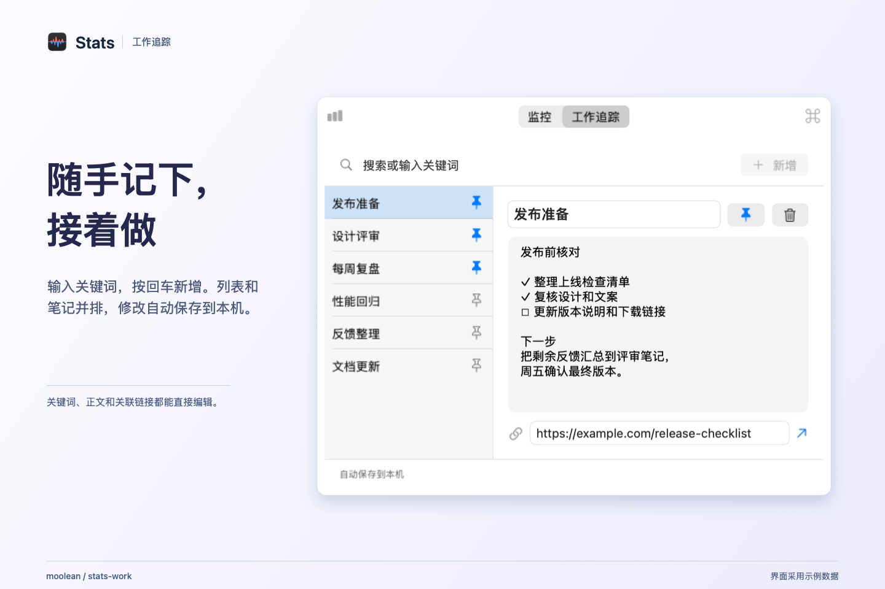
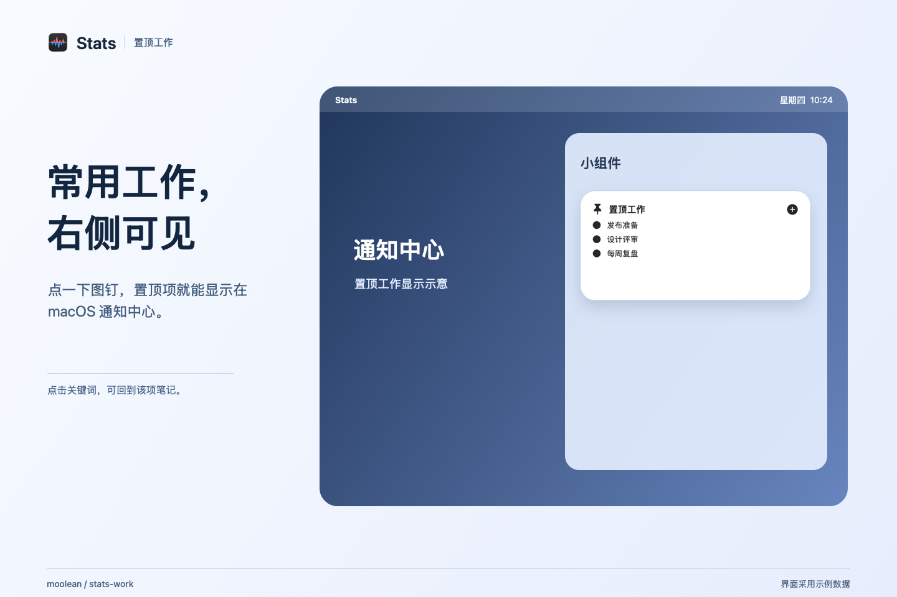

# Stats Work

把 **CPU、内存、进程排行和工作笔记** 放进一个 macOS 菜单栏入口。应用在 Mac 上仍显示为 **Stats**。

[下载 v0.1.0](https://github.com/moolean/stats-work/releases/tag/v0.1.0) · [界面截图](#界面截图) · [本地构建](#本地构建)



## 可以做什么

- **监控系统。** 点菜单栏的双环图标查看 CPU 和内存概览，按 CPU 或内存占用切换进程排行。每行显示进程名、PID 和占用量。
- **随手记工作。** 在「工作追踪」里输入关键词，按回车新增。点工作项即可编辑关键词、笔记和关联链接，修改自动保存到本机。
- **把常用项放到右侧。** 点图钉，再从 macOS 通知中心的「编辑小组件」添加 **Stats → 置顶工作**。点击小组件中的关键词可打开对应笔记。

## 界面截图

宣传图使用应用的原生界面和示例数据。通知中心的背景与外框是示意。

| 监控与进程 | 工作追踪 | 置顶小组件 |
| --- | --- | --- |
| [](docs/screenshots/02-live-monitor.png) | [](docs/screenshots/03-work-tracking.png) | [](docs/screenshots/04-pinned-widget.png) |

原始界面图包括 [CPU 排行](docs/screenshots/native-monitor.png)、[内存排行](docs/screenshots/native-memory.png)、[笔记编辑](docs/screenshots/native-work.png) 和 [小组件内容](docs/screenshots/native-widget.png)。

## 下载与本地构建

[Release](https://github.com/moolean/stats-work/releases/tag/v0.1.0) 附带 `StatsWork-v0.1.0-macos-arm64.zip` 和 SHA-256 校验文件。预览包面向 **Apple Silicon**，最低部署版本为 **macOS 14**，在 macOS Tahoe 26.6.2 上构建。预览包使用临时签名，尚未经过 Apple 公证。

在 Apple Silicon Mac 上安装完整的 Xcode（本次使用 Xcode 26.2）后，可以从源码构建。

```bash
git clone https://github.com/moolean/stats-work.git
cd stats-work
bash packaging/build-release.sh
```

输出位于 `build/release`。构建脚本将应用与 WidgetKit 扩展一起打包，并检查代码签名、版本一致性和 ZIP 校验值。

工作数据保存在 `~/Library/Application Support/com.moolean.stats-work`。置顶小组件读取同一目录下的置顶快照。此版本关闭了 Stats 上游的更新查询。

## 上游与许可证

本项目基于 [Serhiy Mytrovtsiy 的 Stats v3.1.1](https://github.com/exelban/stats/releases/tag/v3.1.1)。系统监控、原有图标和基础界面来自 Stats。工作追踪、置顶小组件和合并面板的改动在此仓库维护。源代码及本仓库修改按 [MIT 许可证](LICENSE) 发布。

## English

Stats Work is a macOS menu bar app based on the open-source Stats project. One status item opens CPU and memory monitoring, process rankings, and a local work notebook. Pinned work items can also appear in a Notification Center widget. The first release includes an Apple Silicon preview and a source build script.
